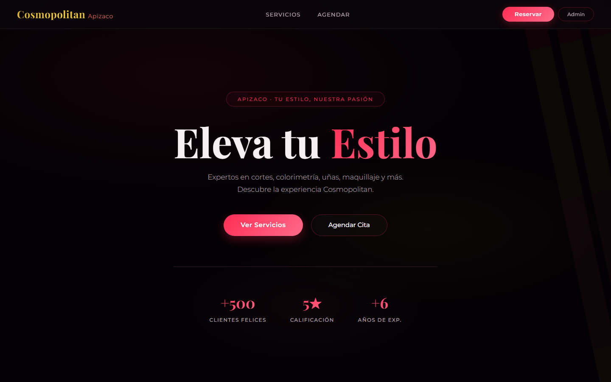
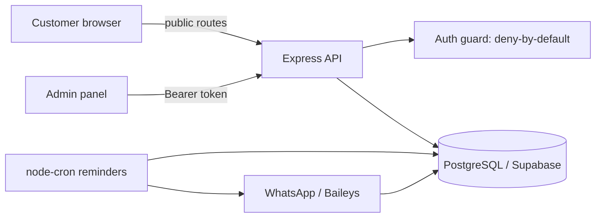

# BarberElite — Barbershop Booking System

[](https://github.com/cantedavid00-afk/barberelite-backend/actions/workflows/test.yml)


**Live demo:** https://barberelite-backend.vercel.app



## Overview

BarberElite is a booking system for barbershops, first used for *Barbería Cosmopolitan*. The repository contains the REST API and the single-page web client it serves: a public booking portal for customers and an admin panel for the shop.

## Business Problem

Appointments were arranged by phone or chat. Nobody had a shared view of which barber was free at what time, the shop had no history of clients and bookings, and reminders were sent by hand.

## Solution

An Express API over PostgreSQL that computes **real availability** (per barber, working hours, blocked days and service duration), stores every appointment, and sends automatic WhatsApp reminders before each visit.

## Key Features

- **Availability engine** (`GET /api/disponibilidad`): free slots per date, considering the barbers qualified for the service category, their schedules, blocked days and existing bookings.
- **Appointments**: book, list, change status, attach payment proof, export to CSV.
- **Catalog & staff**: service categories, services (price, duration), barbers with specialties, weekly schedules and days off.
- **Clients & CRM**: client list and booking history.
- **Scheduled reminders** with `node-cron`: WhatsApp messages 24 h and 1 h before the appointment, with a sent-flag to avoid duplicates and a randomized delay between sends.
- **WhatsApp via Baileys**, with the session stored in PostgreSQL so it survives restarts on free hosting.
- **Multi-tenant**: every query is scoped to a business (`negocio_id`, resolved from a slug).

## Security

- **Admin authentication**: HMAC-signed bearer tokens with expiry, server-side revocation on logout, password stored as a **scrypt hash**, and rate limiting (5 failed attempts per IP / 15 min).
- **Deny-by-default authorization**: every `/api`, `/admin` and `/whatsapp` route requires an admin session except an explicit allow-list used by the public booking portal.
- **No personal data in public responses**: without a session, `/api/citas` only exposes slot occupancy (date, time, status) and staff phone numbers are hidden.
- Customer-provided text is HTML-escaped before rendering in the admin panel (stored-XSS protection); all SQL is parameterized.
- Automated tests (`npm test`) cover unauthorized access, wrong passwords, expired/tampered tokens, logout revocation, public routes and a real server start-up.

## Technology Stack

| Layer | Technology |
|---|---|
| Runtime | Node.js ≥ 18 |
| API | Express 4 |
| Database | PostgreSQL (Supabase) via `pg` |
| Jobs | `node-cron` |
| Messaging | WhatsApp via `@whiskeysockets/baileys`; optional Telegram notifications |
| Client | HTML/CSS/JavaScript SPA served from `public/` |
| Tests | `node:test` (no extra dependencies) |
| Hosting | Render (API) · Vercel (client) |

## Architecture



## Project Structure

```text
server.js              Express app: REST endpoints, availability logic, cron jobs, static hosting
security/admin-auth.js Admin login, signed tokens, rate limiting, deny-by-default route policy
security/public-views.js  Public (PII-free) views of appointments and staff
whatsapp.js            Baileys connection with auth state stored in PostgreSQL
whatsapp-sender.js     Number resolution and robust sending
public/index.html      Booking portal + admin panel
scripts/hash-admin-password.js  Generates ADMIN_PASS_HASH
test/                  Authorization and start-up tests
```

## Installation

Requirements: Node.js 18+ and a PostgreSQL database (Supabase works).

```bash
git clone https://github.com/cantedavid00-afk/barberelite-backend.git
cd barberelite-backend
npm install
cp .env.example .env
npm run hash-admin-password   # paste the output into ADMIN_PASS_HASH
npm run dev                   # http://localhost:3001
npm test
```

### Configuration

`DATABASE_URL`, `ADMIN_SESSION_SECRET` (32+ random characters), `ADMIN_PASS_HASH`, `ADMIN_SESSION_TTL_MINUTES`, `FRONTEND_URL`, `TRUST_PROXY_HOPS`, `ENABLE_WA`, `PORT`. Optional: `TELEGRAM_BOT_TOKEN`, `TELEGRAM_CHAT_ID`. See `.env.example`.

> The database schema is not yet committed; export it from Supabase as `db/schema.sql` before setting up a fresh environment.

## Screenshots

| Booking portal (desktop) | Booking portal (mobile) |
|---|---|
|  |  |

## Status

In use by the shop. Planned: split `server.js` into routes/services, commit the database schema, broaden test coverage.
